<picture>
  <source media="(prefers-color-scheme: dark)" srcset="assets/banner-dark.svg">
  
</picture>

  
  

## Обо мне

Делаю сайты и веб-сервисы целиком: вёрстка по макету, серверная часть, настройка сервера и выкладка.

Пишу код сам и активно использую ИИ-инструменты: Claude Code помогает проектировать, проверять код и снимать рутину. Решения и ответственность за результат — мои.

- 🦅 Развиваю **[SiteFalcon](https://sitefalcon.ru)** — сервис мониторинга сайтов
- 🛠 Сейчас пишу [redirect-generator](https://github.com/Enotik0812/redirect-generator) и [vanilla-ui](https://github.com/Enotik0812/vanilla-ui)
- 💬 Связаться: Telegram [@EnotikNik](https://t.me/EnotikNik)

## Стек

**Языки** 

**CMS** 

**Данные и серверы** 

**Инструменты** 

## Проекты

### 🦅 [SiteFalcon](https://github.com/Enotik0812/sitefalcon) · [sitefalcon.ru](https://sitefalcon.ru)

Мониторинг сайтов 24/7: доступность каждую минуту с серверов в России, SSL и срок домена, поиск следов взлома, контроль форм заявок, отчёт клиенту и уведомления в Telegram. Работает в продакшене, с тарифами и оплатой.

### В работе

| Проект | Что это | Статус |
|---|---|---|
| 🔀 [redirect-generator](https://github.com/Enotik0812/redirect-generator) | Генератор 301-редиректов: отмечаешь правила — получаешь `.htaccess`, конфиг nginx и команды для проверки |  |
| 🧩 [vanilla-ui](https://github.com/Enotik0812/vanilla-ui) | Компоненты на чистом JavaScript без зависимостей: аккордеон, табы, модальное окно, слайдер, оглавление |  |
| 🌐 [personal-site](https://github.com/Enotik0812/personal-site) | Личный сайт-визитка |  |

## Как я работаю

- Сначала тестовый стенд, потом продакшен. Перед правкой — резервная копия и план отката
- Небольшие коммиты с понятными сообщениями
- Результат проверяю инструментами — PageSpeed, валидаторы, curl, — а не «на глаз»
